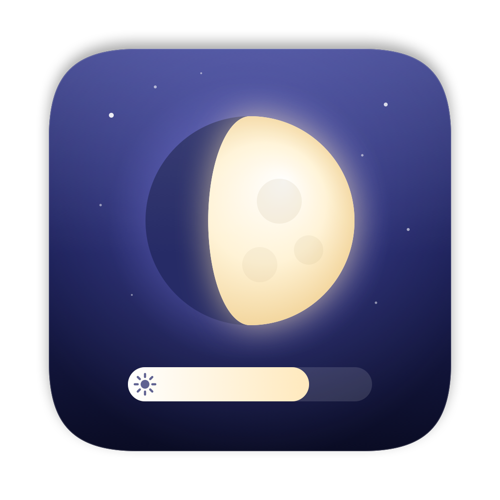
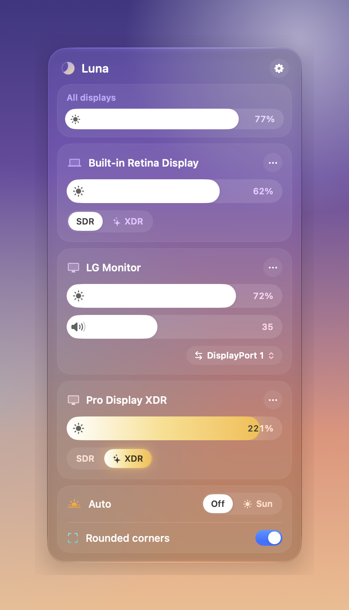
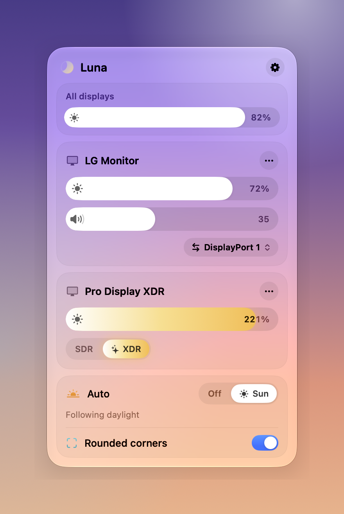
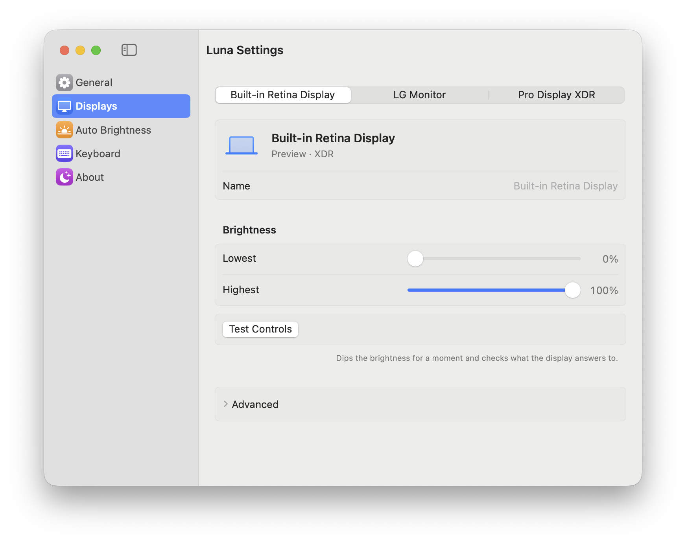

<p align="center"></p>

<h1 align="center">Luna</h1>

<p align="center">Brightness, volume, XDR and rounded corners for every display on your Mac, in one calm panel.<br>Free and open source.</p>

<p align="center"><b><a href="https://github.com/ckakkar/luna/releases/latest/download/Luna.dmg">Download Luna.dmg</a></b> · universal (Apple Silicon and Intel) · macOS 14+ · updates itself</p>

<p align="center">
  
  
</p>

Open the `.dmg` and drag Luna into Applications. The first launch needs **Open Anyway** once in System Settings › Privacy & Security, because the app isn't notarized ([details](USAGE.md#install)). Then click the moon in the menu bar.

**[USAGE.md](USAGE.md)** is the guide: the panel, the keys, auto brightness, XDR, settings and troubleshooting.

## What it does

- **Brightness for every display.** The built-in screen and Apple's monitors through macOS, like the brightness keys. Other monitors over DDC/CI, which changes the monitor's own backlight just like its buttons do. TVs, DisplayLink, Sidecar and AirPlay displays are dimmed in software.
- **Darker than 0%.** The slider carries on past zero into software dimming, for late nights in a dark room. A soft tick marks where 0% is.
- **SDR and XDR.** On displays with HDR headroom (MacBook Pro, Pro Display XDR, HDR monitors), switch to **XDR** and the slider goes past 100% into the brightness the panel keeps for HDR, up to about three times as bright.
- **Volume, mute and input.** For monitors with speakers and several inputs, right in the panel, and only where the monitor supports them. Switching away from the only display asks first.
- **Your keyboard's keys, for every display.** Brightness keys change the display under the pointer (or all of them); volume keys drive a monitor's speakers when macOS can't. Hold ⌥⇧ for fine steps. A small glass indicator shows the level.
- **Auto brightness that learns.** **Match Mac** makes other displays follow the built-in one (which follows the room's light); **Sun** follows daylight where you are. Move a slider and Luna remembers where you like it at that light.
- **Rounded corners** on every screen, like the corners of a MacBook display, in any radius.
- **Turn a display off** without unplugging it, when you have more than one.
- **Global shortcuts** for brighter, dimmer, XDR and rounded corners.

## Why another one

[Lunar](https://github.com/alin23/Lunar) is a remarkable app with every knob there is. Luna is for everyone else: one card per display, and a control appears only when that display supports it. Words instead of jargon: no "sub-zero", gamma tables or DDC timing in the main panel. Settings are a handful of switches; the rest waits under **Advanced**. No licence, no trial, nothing to buy.

<p align="center"></p>

## Privacy

Luna has no analytics and no account. It goes online only to check GitHub for updates. Location (for **Sun**, if you allow it) never leaves your Mac. Accessibility permission lets it see the brightness and volume keys, and only those: it doesn't receive ordinary typing.

## Build from source

Needs macOS 14+ and Swift 6.2+: Xcode 26, or just the Command Line Tools (`xcode-select --install`).

```bash
make install    # build Luna.app and install it in /Applications
make run        # a debug build, opened
make preview    # the panel with made-up displays, for design work
make check      # lint, build and unit tests (what CI runs)
make dmg        # universal Luna.app and Luna.dmg in build/
make            # every task
```

```
Sources/CPrivate/   private macOS display APIs, looked up at runtime (DisplayServices, IOAVService, …)
Sources/LunaCore/   displays, DDC/CI, dimming, XDR, rounded corners, auto brightness; no UI
Sources/Luna/       the app: menu bar panel, indicator, keys, shortcuts, Settings, welcome, updates
Tests/              unit tests for LunaCore (Swift Testing)
scripts/            app bundle, icon, disk image, appcast and release-key scripts
```

See [CONTRIBUTING](CONTRIBUTING.md) for how releases and signing work, [CHANGELOG](CHANGELOG.md), [SECURITY](SECURITY.md) and [CREDITS](CREDITS.md).

## License

[MIT](LICENSE) · app by cyrus
