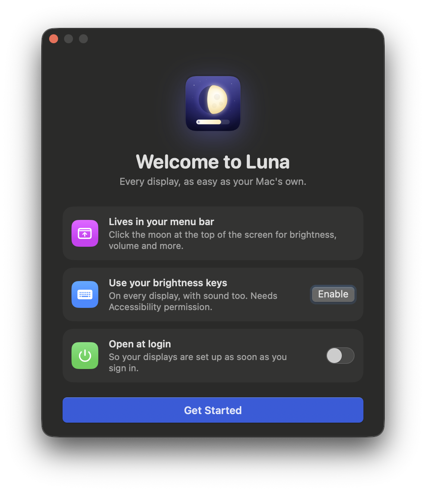
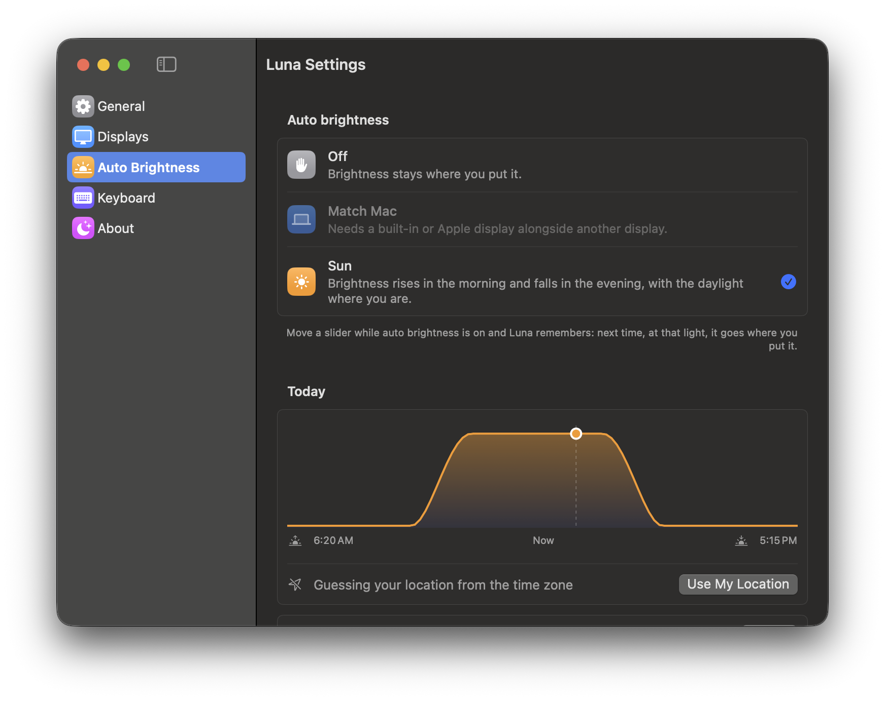

# Using Luna

Luna controls the brightness, volume and more of every display on your Mac, from the menu bar.

**Contents:**
[Install](#install) ·
[The panel](#the-panel) ·
[Below 0% and XDR](#below-0-and-xdr) ·
[Keys and shortcuts](#keys-and-shortcuts) ·
[Auto brightness](#auto-brightness) ·
[Rounded corners](#rounded-corners) ·
[Turning a display off](#turning-a-display-off) ·
[Settings](#settings) ·
[Updates](#updates) ·
[Permissions and privacy](#permissions-and-privacy) ·
[Troubleshooting](#troubleshooting) ·
[Limitations](#limitations)

---

## Install

Download **[Luna.dmg](https://github.com/ckakkar/luna/releases/latest/download/Luna.dmg)**, open it and drag **Luna** into Applications. One download runs on Apple Silicon and Intel Macs (macOS 14 Sonoma or later). From then on Luna [keeps itself up to date](#updates).

> **First launch:** Luna isn't notarized by Apple (that needs a paid developer account), so the first time macOS says it can't verify Luna. Open **System Settings › Privacy & Security**, scroll to the message about Luna and click **Open Anyway**. You only do this once; updates install without asking again.

A welcome window offers the two things worth turning on: the [brightness keys](#keys-and-shortcuts) and **Open at login**.

To build it yourself instead, see [CONTRIBUTING](CONTRIBUTING.md) (`make install`).

**Uninstall:** turn off **Open at login** (Settings › General) and quit Luna (◐ › Quit Luna), then drag it to the Bin. Quitting always puts your displays back as macOS had them.

## The panel

Click the moon in the menu bar. (Right-click it for Settings and Quit.) The moon fills out as the display under the pointer gets brighter.

Each display has a card:

| Control | What it does |
|---|---|
| **Brightness** | Drag or click anywhere on it. Past the tick on the left it [dims below 0%](#below-0-and-xdr); in XDR it goes past 100%. |
| **Volume** | Monitors with speakers. Click the speaker icon to mute. |
| **SDR / XDR** | Displays with HDR headroom. [XDR](#below-0-and-xdr) lets brightness go past 100%. |
| **Input** (⇄) | Monitors with several inputs: switch to another computer or console. If it's your only display, Luna asks first, since you'll need the monitor's buttons to switch back. |
| **⋯** | Contrast (for monitors that have it) and a shortcut to that display's settings. |
| **⏻** | [Turn the display off](#turning-a-display-off) (with more than one display). |

With more than one display, **All displays** at the top moves them all together. Below the cards: [**Auto**](#auto-brightness) brightness and [**Rounded corners**](#rounded-corners).

Controls appear only when a display supports them. A monitor that doesn't speak DDC/CI gets just a brightness slider, which dims it in software.

## Below 0% and XDR

**Below 0%.** Even at its lowest, a backlight can be too bright in a dark room. The left end of the brightness slider (past the small tick) dims further in software, down to about a tenth of the light. The slider turns moonlight blue and shows how far below zero you are. Turn this off in Settings › General › **Dim below 0%**.

**XDR.** MacBook Pros with a Liquid Retina XDR display, the Pro Display XDR and HDR monitors (with HDR on) can shine brighter than their normal maximum; macOS keeps that headroom for HDR video. Choose **XDR** and the brightness slider grows a golden zone past 100%: everything on screen gets brighter, up to about three times. Use it outdoors or in a bright room. It uses more power and warms the display, and very bright whites can lose detail, so switch back to **SDR** when you don't need it. The brightness-up key at 100% switches to XDR too (Settings › General).

## Keys and shortcuts

Luna can take over the keyboard's brightness and volume keys, so they work on every display. Turn this on from the welcome window, the banner in the panel, or Settings › Keyboard. macOS asks for **Accessibility** permission (System Settings › Privacy & Security › Accessibility): Luna needs it to see these keys before macOS does. It sees only the media keys, never ordinary typing.

- **Brightness keys** change the display under the pointer. To change all displays, or always the main one, pick that in Settings › General. On the built-in screen macOS keeps doing it its own way; Luna steps in only for going below 0% or into XDR.
- **Volume keys** change a monitor's speakers when sound plays through the monitor (HDMI or DisplayPort audio), which macOS can't adjust itself. Otherwise they're left to macOS.
- **⌥⇧ + key**: quarter steps, as in macOS.

**Shortcuts** for **Brighter**, **Dimmer**, **XDR on/off** and **Rounded corners on/off** can be set in Settings › Keyboard: click **Record Shortcut** and press the keys (Esc cancels, Delete clears). They work in any app and need no permission.

## Auto brightness

| Mode | What happens |
|---|---|
| **Off** | Brightness stays where you put it. |
| **Match Mac** | Other displays follow the built-in display (or an Apple display), which follows the light in the room. Only offered when there's one to follow. |
| **Sun** | Brightness rises in the morning and falls in the evening, with the daylight where you are. |

**It learns.** While auto brightness is on, move any display's slider and Luna remembers that point: next time it's that bright in the room (or that time of day), the display goes where you put it. Settings › Auto Brightness › **Forget my adjustments** starts over.

For **Sun**, Luna guesses your location from your time zone (good to within an hour or so of real sunrise). Click **Use my location** in the panel or Settings to use the real one; macOS asks once. Settings shows today's daylight curve with sunrise and sunset.

A display you've dimmed below 0% or pushed into XDR is left alone by auto brightness until you bring it back into the normal range.

## Rounded corners

Rounds the corners of every screen, like a MacBook's display: nice on monitors with sharp corners. Toggle it in the panel; set the radius in Settings › General. The corners stay out of screenshots and screen recordings.

## Turning a display off

With two or more displays, **⏻** on a card turns that display off as if it were unplugged: windows move to the others and the GPU stops driving it. It shows in the panel as *Turned off* with **Turn On**. Displays come back on when you quit Luna, when it next starts, after a restart, or if you unplug and replug them. Luna never offers this for your last display.

## Settings

**◐ › ⚙︎ › Settings…** (or ⌘, while a Luna window is open).

- **General:** open at login; which display the brightness keys change; dim below 0%; brightness-up into XDR; volume keys for monitor speakers; rounded corners and their radius; updates.
- **Displays:** for each display:
  - a name of your own;
  - the lowest and highest brightness Luna uses, as a share of the monitor's range;
  - for monitors controlled over DDC, *Lower contrast with brightness*, which dims further than the backlight alone;
  - contrast;
  - **Test Controls**: dips the brightness for a moment and reports what the monitor answers to.
  - **Advanced** holds:
    - **Control:** Automatic, Hardware (DDC) or Software dimming.
    - **Slow monitor:** waits longer between DDC messages.
    - **Input switching:** Standard, or LG for LG monitors that ignore the standard codes.
    - **Dimming below 0%:** colour table or dark overlay.
    - Reset.
- **Auto Brightness:** the three modes, today's daylight, your location, forget adjustments.
- **Keyboard:** the keys' permission and the shortcuts.
- **About:** version, links and credits.

## Updates

Every change published to Luna's GitHub repository becomes a new version within minutes. Luna checks for one shortly after it opens and every hour, and ⚙︎ › **Check for Updates…** checks right away.

When one is found, a dot appears on the menu bar moon and the panel shows **Luna x.y.z is ready**. Click **Update** to see what changed, then **Install Update**. Luna downloads it, verifies its signature (it refuses anything not signed with the project's key), replaces itself and reopens. If the dot goes unnoticed for a day, the update window opens by itself. Turn the automatic check off in Settings › General.

## Permissions and privacy

| Permission | Why | When |
|---|---|---|
| Accessibility | To see the brightness and volume keys | Only if you turn the keys on |
| Location | Sunrise and sunset for **Sun** | Only if you click **Use my location** |
| Login Items | Open at login | Only if you turn it on |

No analytics, no account. The only network traffic is the update check to GitHub.

## Troubleshooting

**A monitor only has a brightness slider, or brightness does nothing.** Luna talks to monitors over DDC/CI. Try these:
- **Check the monitor's own menu.** Many monitors have a "DDC/CI" setting; make sure it's on.
- **Try another port.** Some ports and adapters don't pass DDC through. On M1 Mac minis the built-in HDMI port doesn't. USB-C and Thunderbolt to DisplayPort usually work; cheap hubs and DisplayLink docks often don't.
- **Run Settings › Displays › Test Controls.** It dips the brightness and says what the monitor answered. If the monitor doesn't answer at all, Luna dims it in software instead.

**"This monitor answers DDC but doesn't report its settings."** Many LG monitors work this way: they obey commands but won't say what they're set to. Turn on **Show contrast, volume and input** for that display in Settings › Displays to try those controls. The sliders start from Luna's last value rather than the monitor's.

**Changes are skipped or the monitor flickers.** Turn on **Slow monitor** under Advanced.

**Input switching does nothing on an LG.** Set **Input switching** to **LG** under Advanced.

**XDR doesn't appear.** It needs a display with HDR headroom. On an external HDR monitor, turn on **High Dynamic Range** for it in System Settings › Displays first.

**The keys don't work.** Settings › Keyboard should say they're working. If not:
1. Click **Enable…**.
2. Allow Luna in System Settings › Privacy & Security › Accessibility.
3. If Luna is already listed but the keys still don't work, remove it with **−** and enable it again.

**Dimming below 0% looks wrong with f.lux or another colour app.** Both use the display's colour table. Set **Dimming below 0%** to **Dark overlay** under Advanced.

**Where's the log?** Luna writes what it found about each display to the system log: open Console and search for *Luna*.

## Limitations

- Brightness over DDC depends on the monitor and the cable; not every combination works (see above).
- Luna can't control displays connected through DisplayLink beyond software dimming.
- XDR brightens the whole screen, so HDR video gets brighter too, and very bright whites can clip.
- Luna isn't notarized, hence the one-time **Open Anyway**.
